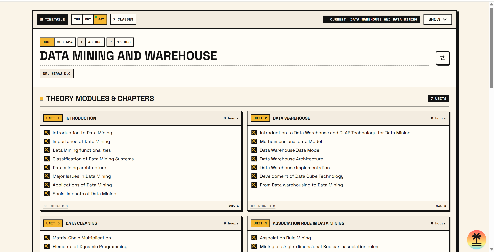

# MTech Study

A study companion for the MTech program. Browse the curriculum by subject, check unit chapters and professors, and see the weekly class timetable. The app also includes a temporary file-sharing page for quick uploads.

## Preview



## Features

- Weekly timetable with day selection and current/upcoming class indicators.
- Subject selector with curriculum, unit hours, professors, and chapter checklists.
- Project implementation and report sections.
- Temporary file uploads at `/upload`, stored in Cloudflare R2 and available for one hour.
- File listing, download, and delete actions.
- Configurable upload count limit and request rate limits.

## Tech stack

- React and TypeScript
- TanStack Start and TanStack Router
- Tailwind CSS
- Cloudflare Workers
- Cloudflare D1 for curriculum data
- Cloudflare R2 for temporary uploads

## Local development

Requirements: Node.js and npm.

```bash
npm install
```

Initialize the local D1 database once. Wrangler uses local storage by default; do not add `--remote` for local development:

```bash
npx wrangler d1 execute mtech-study --file sql_d1_schema/subjects-ddl.sql
npx wrangler d1 execute mtech-study --file sql_d1_schema/subjects_insert.sql
```

Then start the app:

```bash
npm run dev
```

The local D1 database is stored under `.wrangler/state/` and is ignored by Git. The SQL insert script is intended for seeding an empty database; do not rerun it on a database that already contains these subjects.

## Project scripts

| Command | Description |
| --- | --- |
| `npm run dev` | Start the local development server at `http://localhost:3000`. |
| `npm run generate-routes` | Regenerate TanStack Router route types. |
| `npm run cf-typegen` | Generate Cloudflare Worker binding types. |
| `npm run build` | Create the production build. |
| `npm run preview` | Build and preview the production app. |
| `npm run deploy` | Build and deploy the Worker with Wrangler. |

## Data

The home page reads curriculum data from the `subjects` table in the configured D1 database through a TanStack server function. The local schema and seed data are in [`sql_d1_schema/`](sql_d1_schema/). The timetable is a typed static data module at [`src/data/timetable.ts`](src/data/timetable.ts).

## Temporary uploads

The `/upload` page stores anonymous uploads under the `mtech-study-files/` prefix in the `mtech-study-files` R2 bucket. Files are limited to 10 MB each and expire after one hour. `UPLOADS_MAX_FILES` in `wrangler.jsonc` sets the folder capacity and maximum batch size.

The Worker checks the number of unexpired R2 objects before accepting an upload. This count-and-upload check is not serialized, so simultaneous uploads can exceed the configured limit. Expired downloads are rejected immediately; a scheduled Worker trigger removes expired objects every ten minutes.

Anyone who can access the upload page can see file names and download links. Anyone with a download link can access that file until it expires.

## Cloudflare deployment

The D1 binding is configured in `wrangler.jsonc`. Create the R2 bucket once in the target Cloudflare account if it does not already exist:

```bash
npx wrangler login
npx wrangler r2 bucket create mtech-study-files
npm run cf-typegen
npm run deploy
```

The configured rate limits are per client IP: 30 home-page requests, 10 upload requests, and 30 file downloads per 60 seconds. Cloudflare's Rate Limiting API is approximate and tracks limits separately in each Cloudflare location.
